# Magnetogram processing gallery

Generated by `tests/magnetogram_doc_figures/generate_figures.py` for the target time 2026-09-01T00:00:00 UTC (unless stated otherwise). Each figure stacks the variants of one option with a common colour scale. For the filters, the first row is the input map (scaled by 1/2.2 like the outputs) and the right column shows the difference with it, i.e. what the filter removes; the middle column zooms on the dashed box (active-region belt). The title of each panel gives the net-flux imbalance (net / unsigned flux).

## Reading and pre-processing

### HMI: native grid vs resize

HMI_polfil read at its native resolution (1440x3600) and with ``resize=True`` (conservative remap to 360x720). Pipeline input shown.

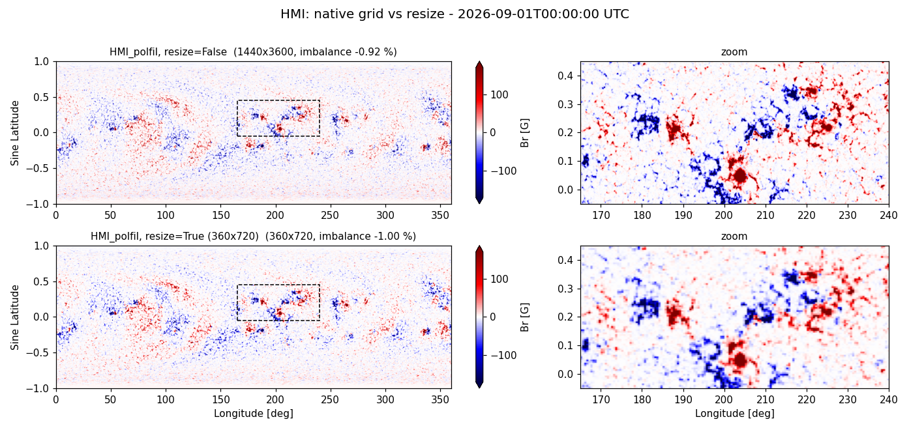

| Run | Method | Parameters | Time [s] | Figure |
|---|---|---|---|---|
| HMI_polfil, resize=False | input | `resize=False` | 3.25 | [png](figures/resize_hmi/native.png) |
| HMI_polfil, resize=True (360x720) | input | `resize=True` | 0.92 | [png](figures/resize_hmi/resized.png) |

### GONG: native grid vs resize

GONG mrzqs read at its native resolution (180x360) and with ``resize=True`` (360x720). Pipeline input shown.

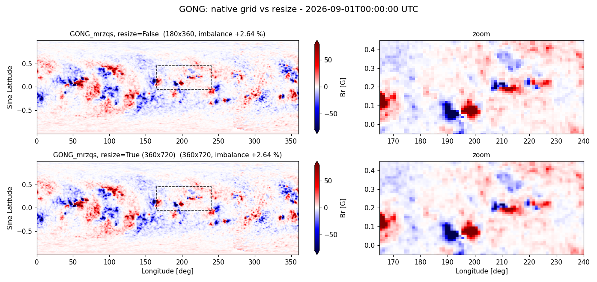

| Run | Method | Parameters | Time [s] | Figure |
|---|---|---|---|---|
| GONG_mrzqs, resize=False | input | `map_type=GONG_mrzqs`, `resize=False` | 2.93 | [png](figures/resize_gong/native.png) |
| GONG_mrzqs, resize=True (360x720) | input | `map_type=GONG_mrzqs`, `resize=True` | 0.4 | [png](figures/resize_gong/resized.png) |

### GONG_mrzqs: temporal interpolation between two maps

GONG_mrzqs: four-map temporal interpolation (``interpolation=True``, order 2) at 2026-08-31T23:44:00, half-way between the maps of 2026-08-31T23:14:00 and 2026-09-01T00:14:00, compared with these two maps read alone (``interpolation=False``). Pipeline input shown; the right column is the difference with the interpolated map.

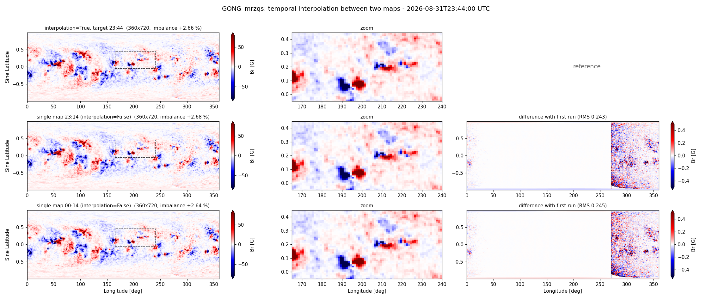

| Run | Method | Parameters | Time [s] | Figure |
|---|---|---|---|---|
| interpolation=True, target 23:44 | input | `map_type=GONG_mrzqs`, `interpolation=True`, `date=2026-08-31T23:44:00` | 3.08 | [png](figures/interpolation_gong_mrzqs/interpolated.png) |
| single map 23:14 (interpolation=False) | input | `map_type=GONG_mrzqs`, `interpolation=False`, `date=2026-08-31T23:14:00` | 0.42 | [png](figures/interpolation_gong_mrzqs/map_before.png) |
| single map 00:14 (interpolation=False) | input | `map_type=GONG_mrzqs`, `interpolation=False`, `date=2026-09-01T00:14:00` | 1.14 | [png](figures/interpolation_gong_mrzqs/map_after.png) |

### HMI_hourly: temporal interpolation between two maps

HMI_hourly: four-map temporal interpolation (``interpolation=True``, order 2) at 2026-08-31T23:54:00, half-way between the maps of 2026-08-31T23:24:00 and 2026-09-01T00:24:00, compared with these two maps read alone (``interpolation=False``). Pipeline input shown; the right column is the difference with the interpolated map.

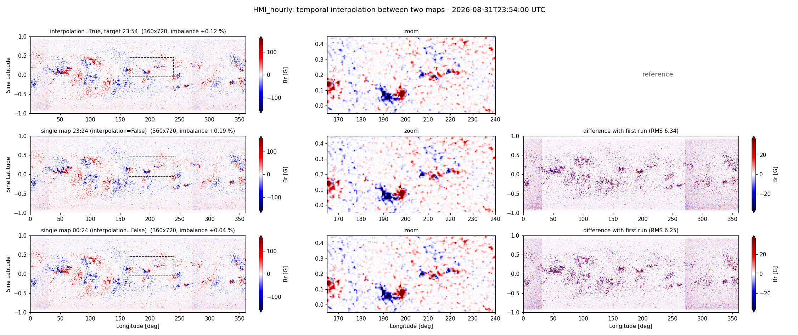

| Run | Method | Parameters | Time [s] | Figure |
|---|---|---|---|---|
| interpolation=True, target 23:54 | input | `map_type=HMI_hourly`, `interpolation=True`, `date=2026-08-31T23:54:00` | 8.57 | [png](figures/interpolation_hmi_hourly/interpolated.png) |
| single map 23:24 (interpolation=False) | input | `map_type=HMI_hourly`, `interpolation=False`, `date=2026-08-31T23:24:00` | 3.81 | [png](figures/interpolation_hmi_hourly/map_before.png) |
| single map 00:24 (interpolation=False) | input | `map_type=HMI_hourly`, `interpolation=False`, `date=2026-09-01T00:24:00` | 3.04 | [png](figures/interpolation_hmi_hourly/map_after.png) |

### ADAPT: temporal interpolation between two maps

ADAPT: four-map temporal interpolation (``interpolation=True``, order 2) at 2026-08-31T23:00:00, half-way between the maps of 2026-08-31T22:00:00 and 2026-09-01T00:00:00, compared with these two maps read alone (``interpolation=False``). Pipeline input shown; the right column is the difference with the interpolated map.

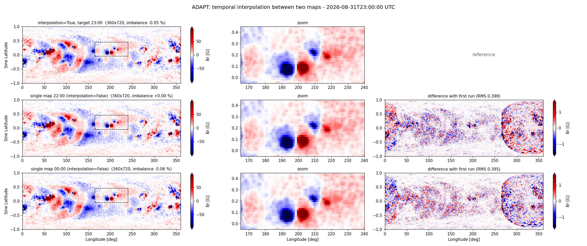

| Run | Method | Parameters | Time [s] | Figure |
|---|---|---|---|---|
| interpolation=True, target 23:00 | input | `map_type=ADAPT`, `interpolation=True`, `date=2026-08-31T23:00:00` | 7.01 | [png](figures/interpolation_adapt/interpolated.png) |
| single map 22:00 (interpolation=False) | input | `map_type=ADAPT`, `interpolation=False`, `date=2026-08-31T22:00:00` | 1.52 | [png](figures/interpolation_adapt/map_before.png) |
| single map 00:00 (interpolation=False) | input | `map_type=ADAPT`, `interpolation=False`, `date=2026-09-01T00:00:00` | 1.11 | [png](figures/interpolation_adapt/map_after.png) |

### Longitude frame: native file, Carrington, Stonyhurst

GONG mrzqs is stored with its first column at Carrington longitude 271.5 deg (the central meridian of the observation is not at the edge of the map). Top: the map in the column order of the FITS file (x axis = position from the first column). Middle: normalised to Carrington longitude 0 first (``carrington=True``). Bottom: rotated to Stonyhurst at the target time (``rotate_to_stonyhurst=True``).

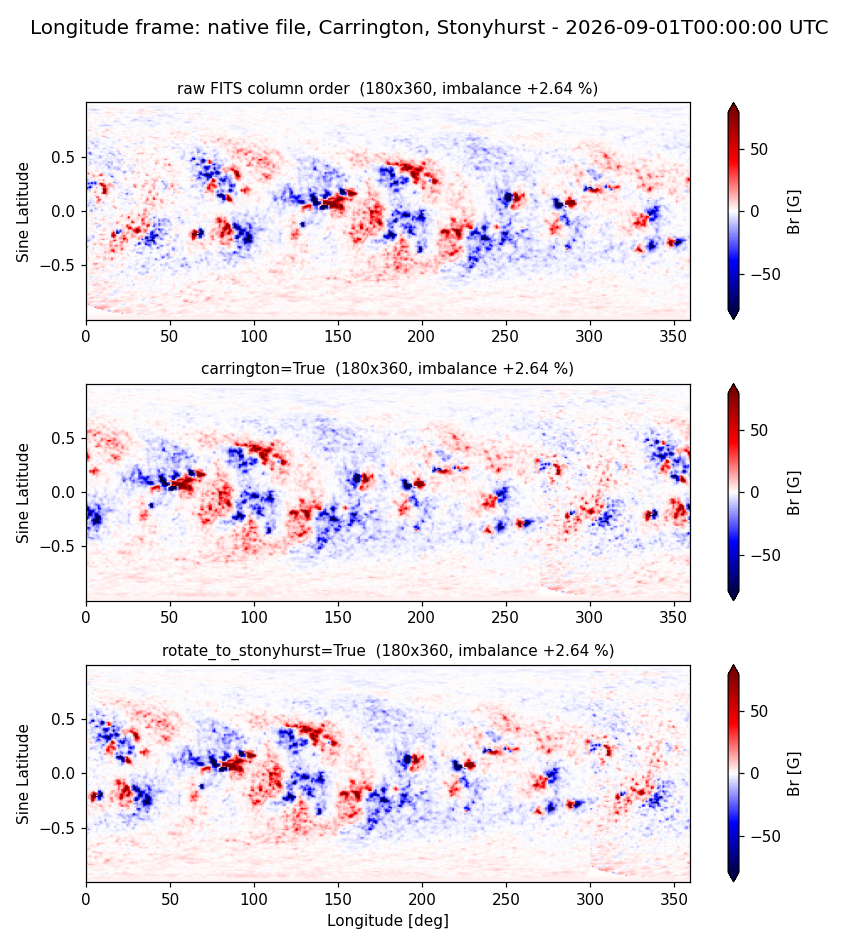

| Run | Method | Parameters | Time [s] | Figure |
|---|---|---|---|---|
| raw FITS column order | native | `map_type=GONG_mrzqs`, `resize=False` | 2.71 | [png](figures/longitude_frame/native.png) |
| carrington=True | input | `map_type=GONG_mrzqs`, `resize=False` | 0.37 | [png](figures/longitude_frame/carrington.png) |
| rotate_to_stonyhurst=True | input | `map_type=GONG_mrzqs`, `resize=False`, `rotate_to_stonyhurst=True` | 0.34 | [png](figures/longitude_frame/stonyhurst.png) |

### ADAPT realizations

Three of the twelve ADAPT realizations (``adapt_map``). Pipeline input shown.

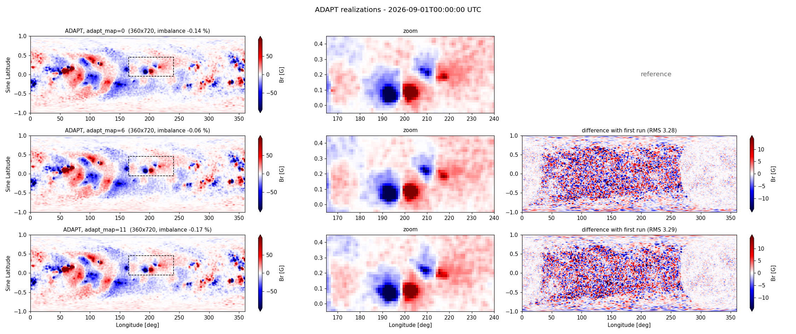

| Run | Method | Parameters | Time [s] | Figure |
|---|---|---|---|---|
| ADAPT, adapt_map=0 | input | `map_type=ADAPT`, `adapt_map=0` | 0.73 | [png](figures/adapt_realizations/adapt_0.png) |
| ADAPT, adapt_map=6 | input | `map_type=ADAPT`, `adapt_map=6` | 0.7 | [png](figures/adapt_realizations/adapt_6.png) |
| ADAPT, adapt_map=11 | input | `map_type=ADAPT`, `adapt_map=11` | 0.81 | [png](figures/adapt_realizations/adapt_11.png) |

### Products at the same time

Different magnetogram products for the same target time, all resized to 360x720. Pipeline input shown.

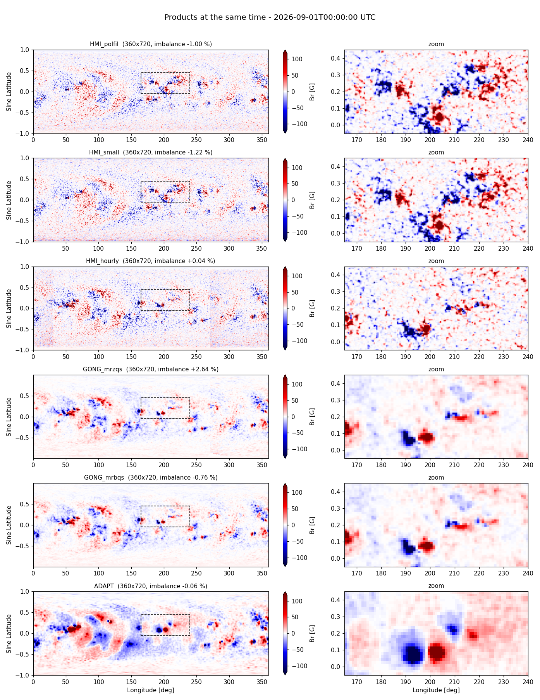

| Run | Method | Parameters | Time [s] | Figure |
|---|---|---|---|---|
| HMI_polfil | input | `map_type=HMI_polfil` | 1.05 | [png](figures/products/hmi_polfil.png) |
| HMI_small | input | `map_type=HMI_small` | 0.4 | [png](figures/products/hmi_small.png) |
| HMI_hourly | input | `map_type=HMI_hourly` | 2.76 | [png](figures/products/hmi_hourly.png) |
| GONG_mrzqs | input | `map_type=GONG_mrzqs` | 0.4 | [png](figures/products/gong_mrzqs.png) |
| GONG_mrbqs | input | `map_type=GONG_mrbqs` | 2.84 | [png](figures/products/gong_mrbqs.png) |
| ADAPT | input | `map_type=ADAPT` | 0.74 | [png](figures/products/adapt.png) |

## Flux correction

### Net-flux correction (method and stage)

HMI_polfil (resized) filtered with the spherical Yaroslavsky filter (``radius_deg=4``, ``h_gauss=100``), which does not conserve the net flux (it adds about +0.4 % of the unsigned flux here): without correction, then ``surface_mean`` and ``polarity_scaling`` applied before or after the filter. Correcting before the filter leaves the imbalance introduced by the filter; only a correction *after* the filter guarantees a written map with zero net flux. The difference column is taken with respect to the uncorrected map.

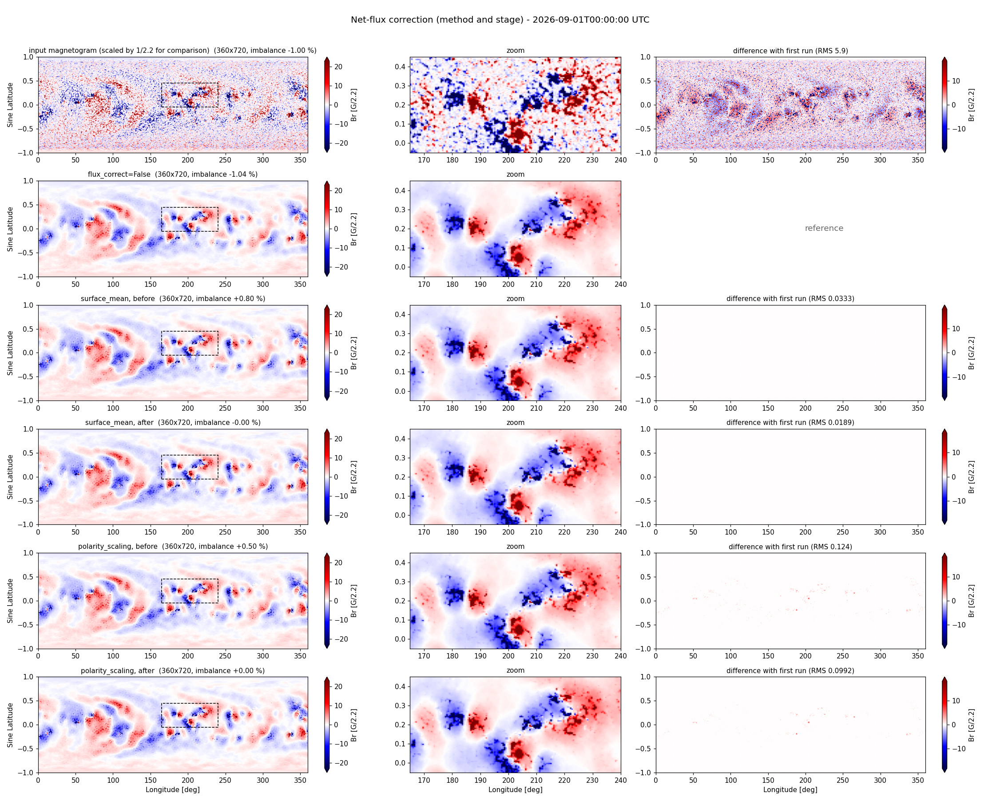

| Run | Method | Parameters | Time [s] | Figure |
|---|---|---|---|---|
| flux_correct=False | yaroslavsky | `radius_deg=4.0`, `h_gauss=100.0` | 1.91 | [png](figures/flux_correction/none.png) |
| surface_mean, before | yaroslavsky | `radius_deg=4.0`, `h_gauss=100.0`, `flux_correct=True`, `flux_correction_method=surface_mean`, `flux_correction_stage=before` | 1.94 | [png](figures/flux_correction/mean_before.png) |
| surface_mean, after | yaroslavsky | `radius_deg=4.0`, `h_gauss=100.0`, `flux_correct=True`, `flux_correction_method=surface_mean`, `flux_correction_stage=after` | 1.93 | [png](figures/flux_correction/mean_after.png) |
| polarity_scaling, before | yaroslavsky | `radius_deg=4.0`, `h_gauss=100.0`, `flux_correct=True`, `flux_correction_method=polarity_scaling`, `flux_correction_stage=before` | 1.88 | [png](figures/flux_correction/polarity_before.png) |
| polarity_scaling, after | yaroslavsky | `radius_deg=4.0`, `h_gauss=100.0`, `flux_correct=True`, `flux_correction_method=polarity_scaling`, `flux_correction_stage=after` | 2.06 | [png](figures/flux_correction/polarity_after.png) |

## Spherical harmonics

### Spherical harmonics: impact of lmax

HMI_polfil (resized) projected on spherical harmonics up to ``lmax`` = 10, 20, 40, 80 (``alpha=0``).

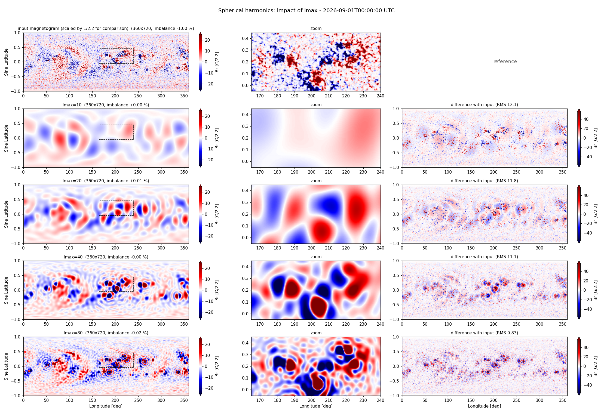

| Run | Method | Parameters | Time [s] | Figure |
|---|---|---|---|---|
| lmax=10 | sph | `lmax=10`, `alpha=0` | 1.07 | [png](figures/sph_lmax/lmax_10.png) |
| lmax=20 | sph | `lmax=20`, `alpha=0` | 1.15 | [png](figures/sph_lmax/lmax_20.png) |
| lmax=40 | sph | `lmax=40`, `alpha=0` | 1.14 | [png](figures/sph_lmax/lmax_40.png) |
| lmax=80 | sph | `lmax=80`, `alpha=0` | 2.57 | [png](figures/sph_lmax/lmax_80.png) |

### Spherical harmonics: impact of alpha

HMI_polfil (resized), ``lmax=40``, damping ``alpha`` = 0, 3e-6, 3e-5, 3e-4.

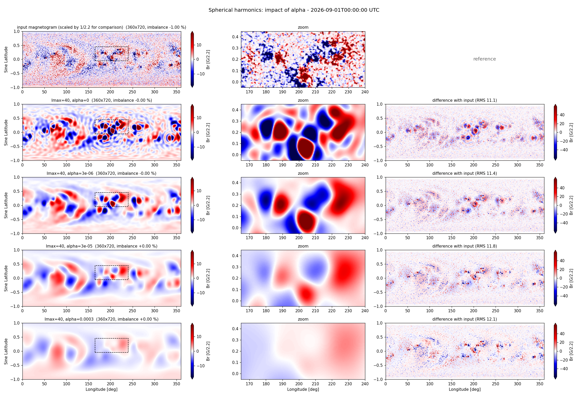

| Run | Method | Parameters | Time [s] | Figure |
|---|---|---|---|---|
| lmax=40, alpha=0 | sph | `lmax=40`, `alpha=0.0` | 1.36 | [png](figures/sph_alpha/alpha_0.png) |
| lmax=40, alpha=3e-06 | sph | `lmax=40`, `alpha=3e-06` | 1.54 | [png](figures/sph_alpha/alpha_3e-06.png) |
| lmax=40, alpha=3e-05 | sph | `lmax=40`, `alpha=3e-05` | 1.25 | [png](figures/sph_alpha/alpha_3e-05.png) |
| lmax=40, alpha=0.0003 | sph | `lmax=40`, `alpha=0.0003` | 1.34 | [png](figures/sph_alpha/alpha_0.0003.png) |

### Spherical harmonics: Gaussian pre-filter

HMI_polfil (resized), ``lmax=40``: no pre-filter, legacy pixel template (``template_size=9``) and physical Gaussian (``sigma_deg=2.0``).

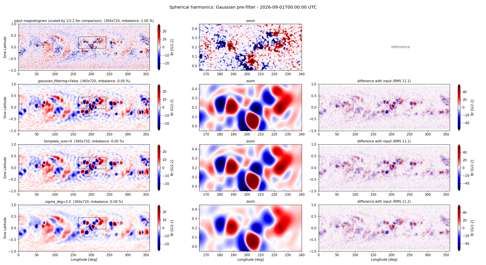

| Run | Method | Parameters | Time [s] | Figure |
|---|---|---|---|---|
| gaussian_filtering=False | sph | `lmax=40` | 1.36 | [png](figures/sph_gaussian_prefilter/off.png) |
| template_size=9 | sph | `lmax=40`, `gaussian_filtering=True`, `template_size=9` | 1.81 | [png](figures/sph_gaussian_prefilter/legacy.png) |
| sigma_deg=2.0 | sph | `lmax=40`, `gaussian_filtering=True`, `sigma_deg=2.0` | 1.65 | [png](figures/sph_gaussian_prefilter/physical.png) |

## Gaussian smoothing

### Gaussian: legacy pixel template vs physical width

HMI_polfil (resized): legacy pixel template (``template_size``) vs great-circle Gaussian with a width in degrees (``sigma_deg``).

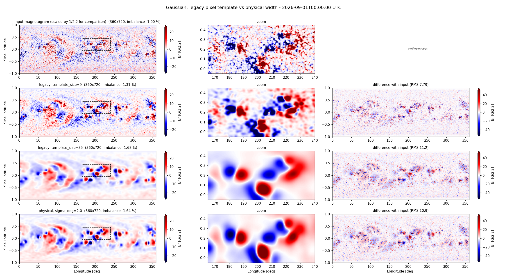

| Run | Method | Parameters | Time [s] | Figure |
|---|---|---|---|---|
| legacy, template_size=9 | gaussian | `template_size=9` | 1.75 | [png](figures/gaussian_old_vs_new/legacy_ts9.png) |
| legacy, template_size=35 | gaussian | `template_size=35` | 7.2 | [png](figures/gaussian_old_vs_new/legacy_ts35.png) |
| physical, sigma_deg=2.0 | gaussian | `sigma_deg=2.0` | 1.73 | [png](figures/gaussian_old_vs_new/physical_2deg.png) |

### Gaussian: grid dependence (legacy vs physical)

The same ``template_size=9`` gives a different physical width on a GONG grid (180x360) and on a resized HMI grid (360x720), whereas ``sigma_deg=2.0`` gives the same smoothing on both.

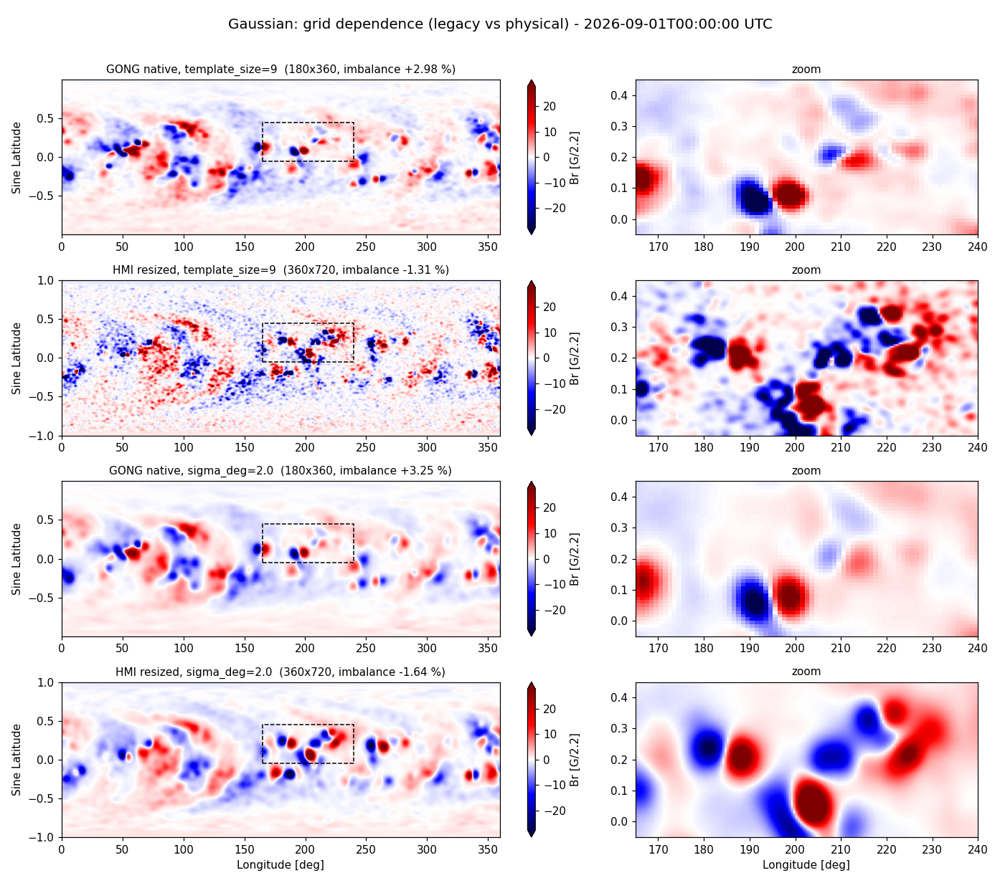

| Run | Method | Parameters | Time [s] | Figure |
|---|---|---|---|---|
| GONG native, template_size=9 | gaussian | `map_type=GONG_mrzqs`, `resize=False`, `template_size=9` | 0.57 | [png](figures/gaussian_grid_dependence/legacy_gong.png) |
| HMI resized, template_size=9 | gaussian | `template_size=9` | 1.41 | [png](figures/gaussian_grid_dependence/legacy_hmi.png) |
| GONG native, sigma_deg=2.0 | gaussian | `map_type=GONG_mrzqs`, `resize=False`, `sigma_deg=2.0` | 0.67 | [png](figures/gaussian_grid_dependence/physical_gong.png) |
| HMI resized, sigma_deg=2.0 | gaussian | `sigma_deg=2.0` | 1.63 | [png](figures/gaussian_grid_dependence/physical_hmi.png) |

### Gaussian: impact of sigma_deg

HMI_polfil (resized), physical Gaussian with ``sigma_deg`` = 1, 2, 4, 8.

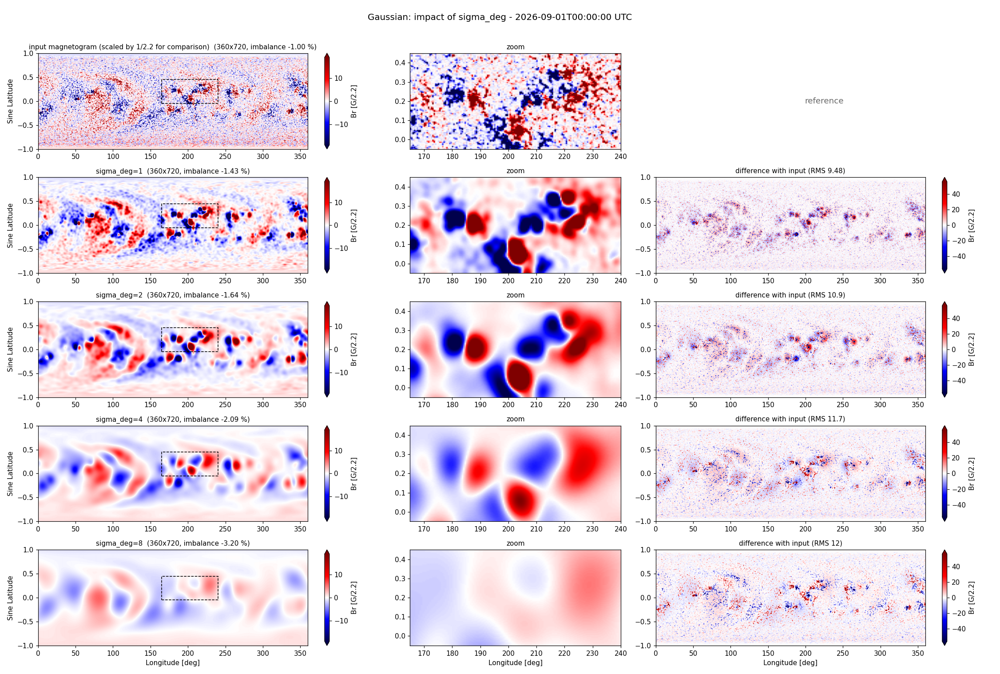

| Run | Method | Parameters | Time [s] | Figure |
|---|---|---|---|---|
| sigma_deg=1 | gaussian | `sigma_deg=1.0` | 1.54 | [png](figures/gaussian_sigma/sigma_1.png) |
| sigma_deg=2 | gaussian | `sigma_deg=2.0` | 1.75 | [png](figures/gaussian_sigma/sigma_2.png) |
| sigma_deg=4 | gaussian | `sigma_deg=4.0` | 2.14 | [png](figures/gaussian_sigma/sigma_4.png) |
| sigma_deg=8 | gaussian | `sigma_deg=8.0` | 2.77 | [png](figures/gaussian_sigma/sigma_8.png) |

## Nonlinear diffusion

### NLD: legacy pixel solver vs spherical solver

HMI_polfil (resized). Legacy: pixel Gaussian (``gaussian_sigma=1``) + Perona-Malik on a Cartesian pixel grid (``tau``, ``iterations``). Spherical: great-circle pre-smoothing + finite-volume diffusion on the sphere (``diffusion_length_deg=2.0``).

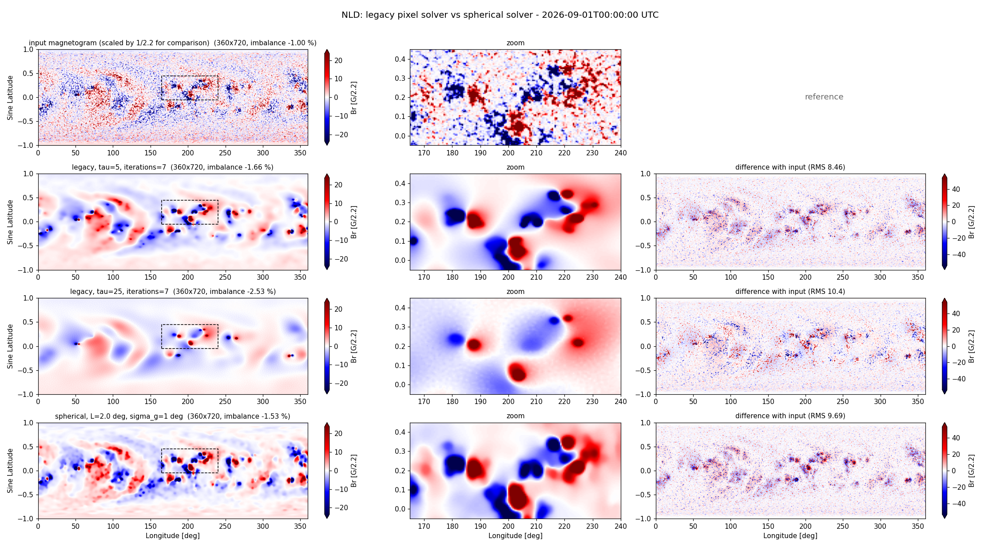

| Run | Method | Parameters | Time [s] | Figure |
|---|---|---|---|---|
| legacy, tau=5, iterations=7 | nld | `tau=5`, `iterations=7`, `gaussian_sigma=1.0` | 27.75 | [png](figures/nld_old_vs_new/legacy_tau5_it7.png) |
| legacy, tau=25, iterations=7 | nld | `tau=25`, `iterations=7`, `gaussian_sigma=1.0` | 28.82 | [png](figures/nld_old_vs_new/legacy_tau25_it7.png) |
| spherical, L=2.0 deg, sigma_g=1 deg | nld | `diffusion_length_deg=2.0`, `gaussian_sigma_deg=1.0` | 2.59 | [png](figures/nld_old_vs_new/spherical.png) |

### NLD (spherical): impact of diffusion_length_deg

HMI_polfil (resized), spherical NLD with ``diffusion_length_deg`` = 1, 2, 4 (``gaussian_sigma_deg=1``, automatic lambda).

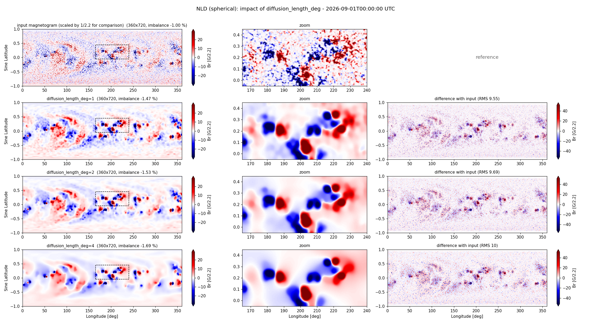

| Run | Method | Parameters | Time [s] | Figure |
|---|---|---|---|---|
| diffusion_length_deg=1 | nld | `diffusion_length_deg=1.0`, `gaussian_sigma_deg=1.0` | 2.89 | [png](figures/nld_length/L_1.png) |
| diffusion_length_deg=2 | nld | `diffusion_length_deg=2.0`, `gaussian_sigma_deg=1.0` | 2.77 | [png](figures/nld_length/L_2.png) |
| diffusion_length_deg=4 | nld | `diffusion_length_deg=4.0`, `gaussian_sigma_deg=1.0` | 2.58 | [png](figures/nld_length/L_4.png) |

### NLD (spherical): impact of lambda

HMI_polfil (resized), ``diffusion_length_deg=2.0``: automatic lambda (area-weighted MAD) vs fixed ``lambda_g_per_deg``. A small lambda preserves strong gradients (active regions), a large one tends to a linear (Gaussian) diffusion.

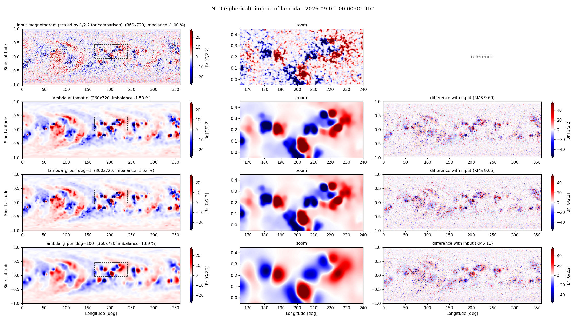

| Run | Method | Parameters | Time [s] | Figure |
|---|---|---|---|---|
| lambda automatic | nld | `diffusion_length_deg=2.0`, `gaussian_sigma_deg=1.0` | 2.89 | [png](figures/nld_lambda/auto.png) |
| lambda_g_per_deg=1 | nld | `diffusion_length_deg=2.0`, `gaussian_sigma_deg=1.0`, `lambda_g_per_deg=1.0` | 2.43 | [png](figures/nld_lambda/lambda_1.png) |
| lambda_g_per_deg=100 | nld | `diffusion_length_deg=2.0`, `gaussian_sigma_deg=1.0`, `lambda_g_per_deg=100.0` | 2.53 | [png](figures/nld_lambda/lambda_100.png) |

## Yaroslavsky (local weighted) filter

### Yaroslavsky: legacy pixel filter vs spherical filter

GONG mrzqs (native 180x360, the legacy filter is slow on larger grids). Legacy: neighbourhood ``Rn`` in pixels, ``alpha``, pixel pre-smoothing ``sig``. Spherical: disk of radius ``radius_deg`` on the sphere, automatic ``h_gauss``, great-circle pre-smoothing ``sig_deg``.

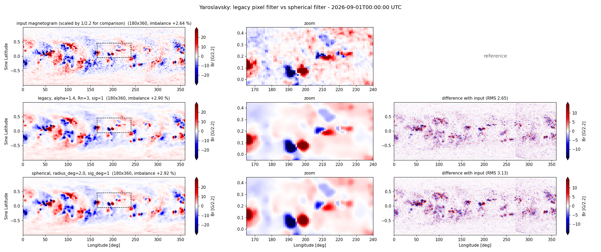

| Run | Method | Parameters | Time [s] | Figure |
|---|---|---|---|---|
| legacy, alpha=1.4, Rn=3, sig=1 | yaroslavsky | `map_type=GONG_mrzqs`, `resize=False`, `alpha=1.4`, `Rn=3`, `sig=1.0` | 10.14 | [png](figures/yaroslavsky_old_vs_new/legacy.png) |
| spherical, radius_deg=2.0, sig_deg=1 | yaroslavsky | `map_type=GONG_mrzqs`, `resize=False`, `radius_deg=2.0`, `sig_deg=1.0` | 0.46 | [png](figures/yaroslavsky_old_vs_new/spherical.png) |

### Yaroslavsky (spherical): impact of radius_deg

HMI_polfil (resized), spherical filter with ``radius_deg`` = 1, 2, 4, no pre-smoothing, ``h_gauss=20``. (With the automatic h, about 3 G here, only pixels within a few Gauss of each other are averaged and the radius has little effect; see the h_gauss group.)

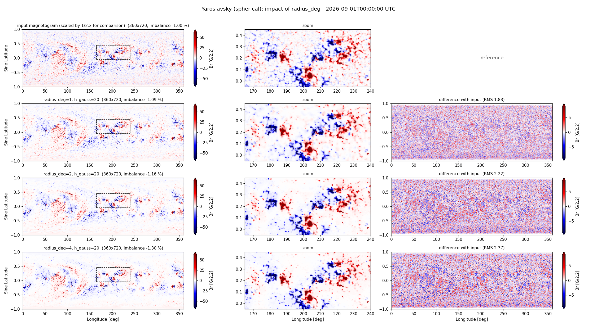

| Run | Method | Parameters | Time [s] | Figure |
|---|---|---|---|---|
| radius_deg=1, h_gauss=20 | yaroslavsky | `radius_deg=1.0`, `h_gauss=20.0` | 1.36 | [png](figures/yaroslavsky_radius/r_1.png) |
| radius_deg=2, h_gauss=20 | yaroslavsky | `radius_deg=2.0`, `h_gauss=20.0` | 1.74 | [png](figures/yaroslavsky_radius/r_2.png) |
| radius_deg=4, h_gauss=20 | yaroslavsky | `radius_deg=4.0`, `h_gauss=20.0` | 2.45 | [png](figures/yaroslavsky_radius/r_4.png) |

### Yaroslavsky (spherical): impact of h_gauss

HMI_polfil (resized), ``radius_deg=2.0``: automatic ``h_gauss`` vs fixed values. A small h only averages similar values (edge preserving), a large h tends to a plain disk average. No pre-smoothing.

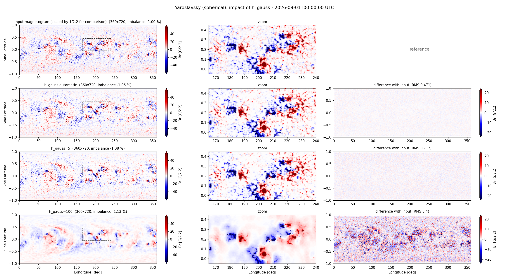

| Run | Method | Parameters | Time [s] | Figure |
|---|---|---|---|---|
| h_gauss automatic | yaroslavsky | `radius_deg=2.0` | 1.5 | [png](figures/yaroslavsky_h/auto.png) |
| h_gauss=5 | yaroslavsky | `radius_deg=2.0`, `h_gauss=5.0` | 1.26 | [png](figures/yaroslavsky_h/h_5.png) |
| h_gauss=100 | yaroslavsky | `radius_deg=2.0`, `h_gauss=100.0` | 1.41 | [png](figures/yaroslavsky_h/h_100.png) |

## Comparison of the filters

### Comparison of the filters

HMI_polfil (resized) processed by each pipeline with comparable physical scales: spherical harmonics (lmax=20), Gaussian (sigma=2.0 deg), spherical NLD (L=2.0 deg), spherical Yaroslavsky (radius=2.0 deg). All with surface_mean flux correction after the filter (before for the spherical harmonics).

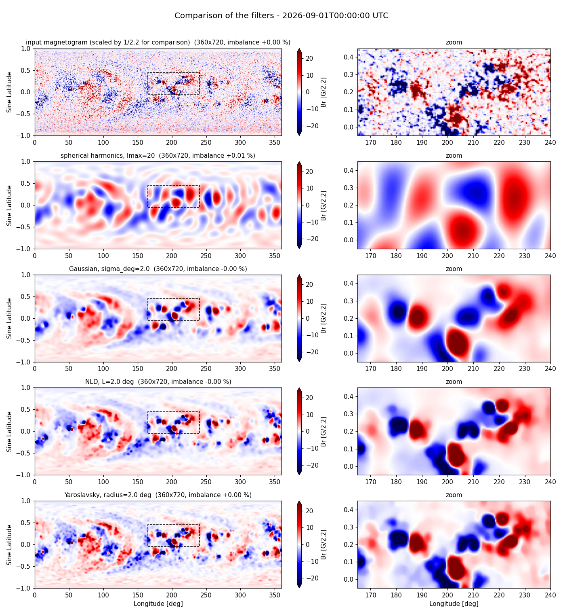

| Run | Method | Parameters | Time [s] | Figure |
|---|---|---|---|---|
| spherical harmonics, lmax=20 | sph | `lmax=20`, `flux_correct=True` | 0.99 | [png](figures/methods/sph.png) |
| Gaussian, sigma_deg=2.0 | gaussian | `sigma_deg=2.0`, `flux_correct=True` | 1.41 | [png](figures/methods/gaussian.png) |
| NLD, L=2.0 deg | nld | `diffusion_length_deg=2.0`, `gaussian_sigma_deg=1.0`, `flux_correct=True` | 2.83 | [png](figures/methods/nld.png) |
| Yaroslavsky, radius=2.0 deg | yaroslavsky | `radius_deg=2.0`, `sig_deg=1.0`, `flux_correct=True` | 1.74 | [png](figures/methods/yaroslavsky.png) |
